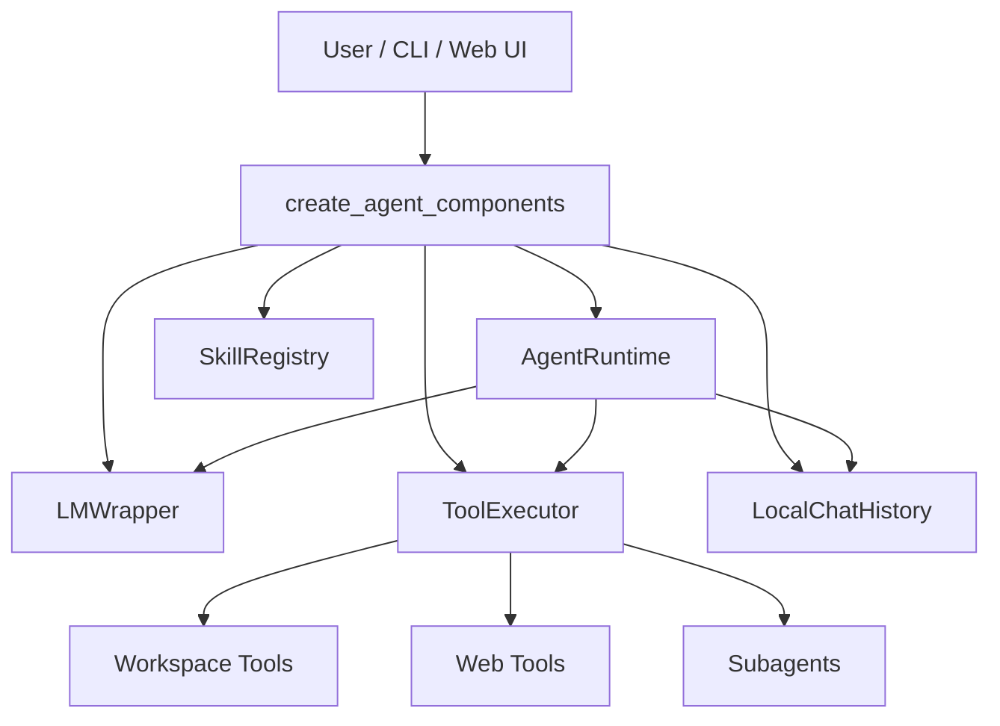

# agentic-sdk

可擴充的 Python AI Agent 框架範本。將提示詞、Skills、Tools、對話紀錄與 `AgentRuntime` 執行迴圈組成可重複使用的管線，並附 Web 除錯 UI 與多語系文件。

## 架構



## 快速開始

### 1. 安裝依賴

```bash
pip install -r requirements.txt
playwright install chromium
```

### 2. 設定環境變數

```bash
cp .env.example .env
# 編輯 .env，填入 GEMINI_KEY 等金鑰
```

### 3. CLI 示範

```bash
python main.py
```

### 4. Web 除錯 UI

```bash
python web_app.py
```

瀏覽器開啟 `http://127.0.0.1:15220`，可進行對話除錯、瀏覽 SDK 文件與 How-to 教學。

## 目錄結構

```
agentic-sdk/
├── src/
│   ├── agent_factory.py      # 組裝入口：create_agent_components()
│   ├── ai_core/              # Runtime、LLM、History、Compression
│   └── tools/                # 內建工具（工作區、網頁、子代理等）
├── prompts/                  # 系統提示詞範本
├── skills/                   # 技能 SOP（video_planner、video_director）
├── templates/                # HTML 模板與 Web UI
├── docs/
│   ├── SDK/                  # 模組 API 參考（JSON）
│   └── how-to/               # 多語教學（zh-Hant / en / ja）
├── static/                   # Web UI 靜態資源
├── units_tsts/               # 測試腳本
└── utils/                    # 實驗性工具（EmbeddingModelWrapper）
```

## 核心概念

| 概念 | 說明 |
|------|------|
| `create_agent_components()` | 一次建立 runtime、session、llm、tool_executor 等元件 |
| `AgentRuntime.run()` | 多步推理迴圈；模型可呼叫工具直到任務完成 |
| `LocalChatHistory` | 對話存成 `chat_history/<id>.json`，是除錯的 source of truth |
| Skills | SOP 文字，透過 `lookup_skill` 按需載入 |
| Tools | 可執行的程式工具（掃描工作區、爬蟲、子代理等） |

## 文件

- [快速開始](docs/how-to/zh-Hant/01-quick-start.md)
- [設定與環境變數](docs/how-to/zh-Hant/02-configuration.md)
- [架構說明](docs/how-to/zh-Hant/04-architecture.md)
- [工具開發](docs/how-to/zh-Hant/06-tool-authoring.md)
- [技能開發](docs/how-to/zh-Hant/07-skill-authoring.md)
- [Web API 說明](docs/API.md)

啟動 `web_app.py` 後也可在瀏覽器直接瀏覽 `/docs` 與 `/docs/how-to`。

## 授權

[MIT License](LICENSE)
